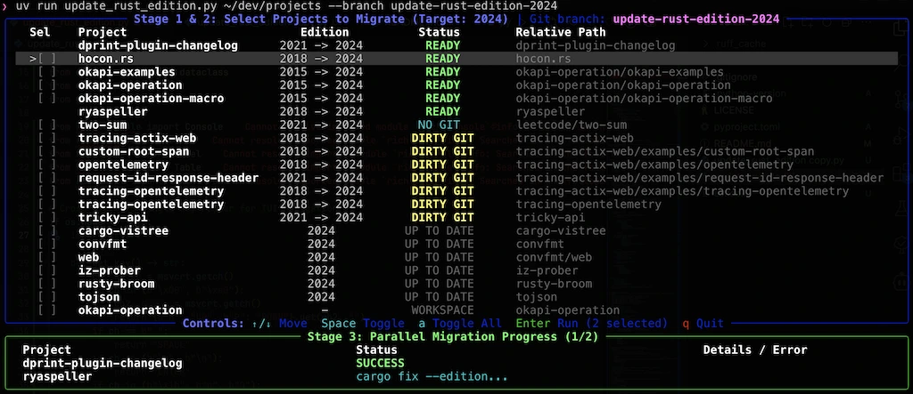

# update-rust-edition

An interactive TUI and parallel CLI tool for recursively updating the Rust `edition` across multiple projects within a directory.

<p align="center">
  
</p>


## Features

* **3-Stage Interactive TUI**:
  1. **Discovery & Status Scan**: Recursively locates `Cargo.toml` files and evaluates their current edition and Git working tree status with color-coded badges (`READY`, `DIRTY GIT`, `UP TO DATE`, `WORKSPACE`).
  2. **Interactive Selection**: Navigate projects with arrow keys (`↑`/`↓` or `j`/`k`), toggle individual projects with `Space`, toggle all with `a`, and confirm execution with `Enter`.
  3. **Live Parallel Execution**: Tracks real-time progress across worker threads (`git checkout`, `cargo update`, `cargo fix`, `Cargo.toml` update, `cargo test --no-run`, `cargo fmt` and `cargo clippy --fix`).
* **Separate Git Branch Support (`--branch`)**: Automatically creates and checks out a dedicated Git branch (or switches to it if it already exists) in every selected repository before applying changes.
* **Zero-Setup Execution via `uv`**: Includes PEP 723 inline script metadata (`# /// script`) so `uv` automatically installs `rich` in an isolated environment without manual setup.


## Running with uv

Run the script directly with `uv run`. `uv` will handle dependency resolution automatically:

### 0. Ensure your rustc is up to date
Make `rustup update`

### 1. Interactive TUI with a Dedicated Git Branch (Recommended)

Scan projects, select which ones to migrate in the TUI, and apply changes on a new branch `chore/rust-edition-2024`:

```bash
uv run update_rust_edition.py /path/to/projects --edition 2024 --branch chore/rust-edition-2024
```

### 2. Non-Interactive Dry-Run Scan

Print the color-coded Stage 1 discovery table (editions and Git status) and exit without launching the interactive selector or modifying files:

```bash
uv run update_rust_edition.py /path/to/projects --workers 4 --dry-run
```

## CLI Arguments & Options

| Argument / Flag | Default | Description |
| :--- | :--- | :--- |
| `directory` | `.` (current folder) | Root directory to recursively search for Rust projects. |
| `--edition` | `2024` | Target Rust edition (`2015`, `2018`, `2021`, `2024`). |
| `--branch` | `None` | Create or check out a separate Git branch before updating each project. |
| `--workers` | `min(4, CPU cores)` | Maximum number of projects to migrate in parallel. |
| `--dry-run` | `False` | Run Stage 1 scan only and print the status table without modifying files. |
